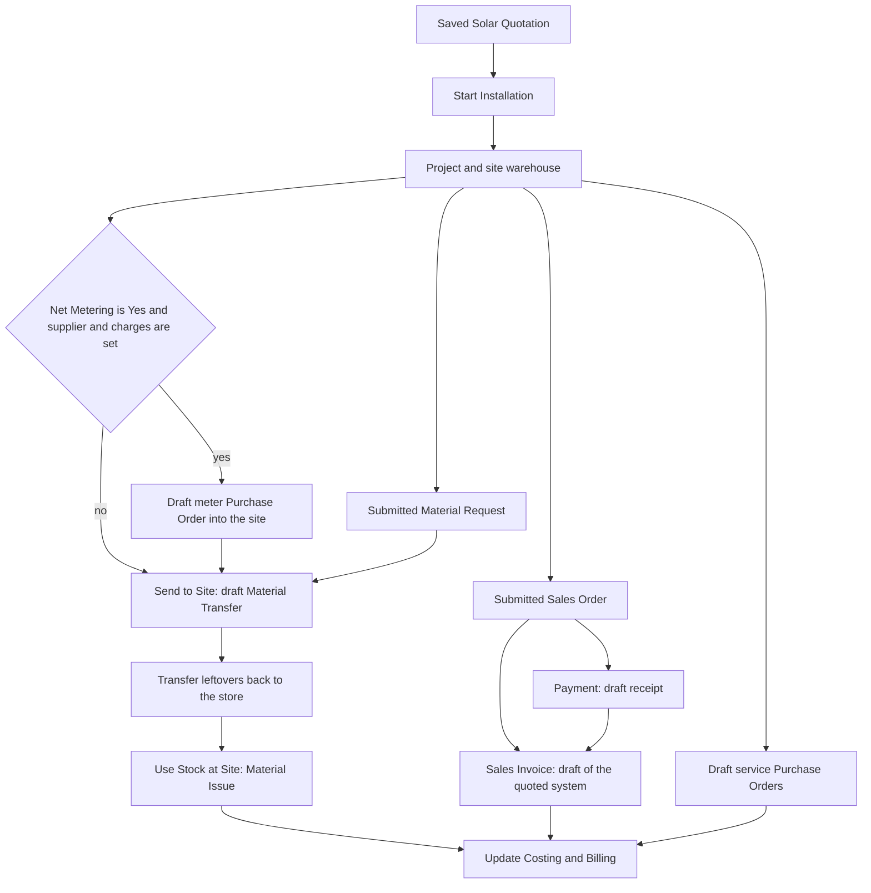

# Solar installation accounting

This is the record of how a solar job makes profit, which account each document uses, and why those choices were made. The code that follows these rules is `solar/accounts.py` and `solar/installation.py`.

Company RMC Traders (abbreviation RTD) is the site this was checked against. The app does not hardcode `RTD`. It builds account, cost center, and warehouse names from the company abbreviation, then falls back to the company defaults.

## Project profit

ERPNext calculates project gross margin in `Project.calculate_gross_margin`:

```text
gross margin = total billed
             - timesheet cost
             - purchase cost
             - consumed material cost
```

Only submitted documents count. A draft never changes the margin.

| Project figure | What fills it | What this app does |
| --- | --- | --- |
| Total billed | Submitted Sales Invoice. The line's project is used. If the line has no project, the invoice header project is used. | One submitted line, item Solar Installation, rate = quoted total, project on the line. |
| Purchase cost | Sum of `base_net_amount` on submitted Purchase Invoice lines whose project is this project. Stock and non-stock lines both count. | Service bills only. The meter bill must not carry the project. |
| Consumed material | Submitted Stock Entry rows with this project and an empty target warehouse. | One Material Issue of the site warehouse when the job is finished. |
| Timesheet cost | Submitted timesheets on the project. | This app creates none. A timesheet added by hand would still reduce the margin. |

A Sales Order updates Total Sales Amount. It does not update Total Billed Amount, so submitting the order does not book income.

A Payment Entry does not appear in the formula. Its ledger is bank against receivable (or an advance). Tagging the payment with the project lets the money be traced. It does not raise or lower project profit.

After the closing stock issue, run **Update Costing and Billing** on the project. Submitting the issue also writes consumed material cost, and the button refreshes billed amount and purchase cost together.

## Account map

Perpetual inventory is on for RMC Traders. That is a condition of this design. A stock purchase then debits inventory, not an expense. Expense is recognised later, when the stock leaves.

| Movement | Item | Account debited | Account credited | Project on the line |
| --- | --- | --- | --- | --- |
| Customer invoice | Solar Installation, qty 1, rate = quoted total | Debtor | Sales (the item income account, Sales - RTD) | Yes |
| Installer, structure, earthing bore, net-metering bill | The four service items below | Solar Job Cost - RTD | Creditor | Yes |
| Buy 2 Green Meters into the site | Green Meter, stock | Stock In Hand - RTD, through Stock Received But Not Billed | Creditor | No |
| Trip from the store to the site | Panels, inverter, wire, and the other store items | Stock In Hand at the site | Stock In Hand at the store | No |
| Finish the job | Whatever is still in the site warehouse, including the meters | Cost of Goods Sold - RTD | Stock In Hand at the site | Yes |
| Client payment | None | Bank or cash | Debtor, or an advance if the invoice is not submitted yet | Stored on the payment, ignored by the margin |

Solar Job Cost is a ledger under the Direct Expenses group. The app creates `Solar Job Cost - {abbr}` when it is missing. Service items get that account on their Item Default for the company. Their income account is left as Sales, because the same Solar Installation item is also what the customer is invoiced for. A sale reads the income account. A purchase reads the expense account.

Cost of Goods Sold is the company default expense account (`Company.default_expense_account`). The closing Material Issue writes that account on every row. The meter purchase order may display Cost of Goods Sold on the line because that is the stock item's default, but perpetual inventory does not debit it on the purchase. The debit happens on the closing issue, once, at the stock valuation.

Cost center on every project document is `Solar Business - {abbr}` when that cost center exists, otherwise the company cost center. On RMC Traders that is Solar Business - RTD, and the company fallback is Main - RTD.

## Flow



Start Installation stops if the quotation already points at a Project that exists. It also stops when the quoted total, the client, or the item Solar Installation is missing.

## What each button creates

### Start Installation

Creates, in one transaction:

1. Project named `{quotation} - Solar Installation`, customer = `client_name`, cost center as above.
2. Warehouse `Site for {quotation} - {abbr}` under the group warehouse `Sites - {abbr}`. The group must already exist.
3. Material Request, type Material Transfer, submitted. Submitting a request does not move stock. Each stock row's target warehouse is the site and its source is Stock Settings `default_warehouse` (Jamal Pura - RTD on this company). The row has no project. This ERPNext has no project field on Material Request, so the request is stored on the quotation.
4. Sales Order, submitted, one line: Solar Installation, quantity 1, rate = `total_quoted_amount`, project and cost center on the header and the line. No income is booked. The order exists so a payment can be allocated before the invoice.
5. Draft Purchase Orders for services, grouped by supplier, project on the header and on each line, expense account Solar Job Cost.
6. When the meter rule below passes, one more draft Purchase Order for 2 Green Meters, warehouse = site, no project.

A missing supplier, a missing service item, or a missing meter price is a warning. The rest of the job is still created. A missing stock item code on the quotation stops the start, because the material request would be wrong.

### Send to Site

Builds a draft Stock Entry from the material request for the quantity still outstanding. The project is cleared on the header and on every row before save, because a Stock Entry copies its header project onto rows and a later issue must be the only stock row that carries the project. The user lowers the quantities to this trip and submits. Quantity removed from the draft stays outstanding on the request for the next trip. The transfer debits and credits inventory only.

### Sales Invoice

Draft invoice made from the sales order. It refuses to save if any line is not Solar Installation. Project and cost center are set on the line. Payments already made against the order are pulled onto the invoice as advances. Submit the invoice to book income. Stock items stay off it. Print **Solar Material List** from the quotation for the panels, inverter, and the rest.

### Payment

Draft Payment Entry for the full open balance. If the sales invoice is submitted, the receipt is against that invoice. Otherwise it is against the sales order. Reference No is the quotation name and Reference Date is today, because a bank account cannot be saved without them. Change both, and lower the amount when the client is paying less, then submit. Another payment can be made later for another amount.

### Use Stock at Site

Material Issue for every bin in the site warehouse with quantity on hand. Each row has the project, cost center Solar Business, expense account Cost of Goods Sold, source warehouse = the site, and no target warehouse. The empty target is what makes ERPNext treat the row as consumed material. If any item has a serial or a batch, the issue stays a draft so those numbers can be entered. Otherwise it is submitted.

Move leftovers back to the store before this step. Anything still in the site warehouse is expensed to the project.

## Service lines

A service row is added only when both the rate and the quantity are set. Net-metering charges need only the rate, and the quantity is 1.

| Cost | Item | Quantity | Rate | Supplier field | Expense account | Project |
| --- | --- | --- | --- | --- | --- | --- |
| Installer | Solar Installation | watts | solar installer charge per watt | solar installer | Solar Job Cost | Yes |
| Structure | Solar Customized Structure | total panels | solar structure charges | solar structure installer | Solar Job Cost | Yes |
| Earthing bore | Earthing Bor | earthing quantity | earthing bor | earthing bore supplier | Solar Job Cost | Yes |
| Net-metering paperwork | Net Metering Processing Charges | 1 | net meter charges | net meter supplier | Solar Job Cost | Yes |

Using Solar Installation for both the customer invoice and the installer bill is deliberate. The sale hits Sales. The purchase hits Solar Job Cost. The quantities are different: the customer line is quantity 1 at the quoted total, and the installer line is the watt count at the per-watt rate.

These four items must stay non-stock. The app refuses to set the expense account if one of them is a stock item, because the purchase would hit the project and the closing issue would hit it again.

The expense account is saved on Item Default with mandatory checks ignored. Solar Installation requires a brand, and a normal item save was failing on that empty brand. The income account is not changed.

Submit the draft purchase order and then its purchase invoice. Until that invoice is submitted, the service cost is not in the project margin.

## Meters

WAPDA requires two meters. They are purchased only when Net Metering is Yes. Quantity is always 2. The rate is the green meter charges divided by 2. They are received into the site warehouse.

They are not put on the material request. They are not transferred from the store. The old form script treated the word "No" as true and always added two meters; that is removed.

The meter purchase order and its invoice must not have the project. Purchase cost sums every submitted purchase line that has the project, stock or not. The closing issue then adds the same meters again as consumed material. Leaving the project off the purchase means the cost is counted once, on the issue, at stock valuation.

A comment on the meter order says the same thing. If the supplier or the charges are missing, Start Installation warns and does not create the order.

When Net Metering is No, no meters are purchased.

## Store material

These child tables become the material request, with quantities added together by item code:

- panels
- inverters
- DC wires
- AC wires
- earthing wires
- distribution boards
- earthing items
- miscellaneous items
- the battery, only when Battery is Yes, using battery item code and battery quantity

The commercial quotation table (the PDF lines) is not stock and is not requested. Green Meter is removed even if it was typed onto one of the tables. A non-stock item on those tables is skipped with a warning.

The request is submitted so each trip can be a partial stock entry. The full transfer is not created at the start, because material goes to the site in steps.

## Expense-account decisions

1. **Services use Solar Job Cost, under Direct Expenses.** Installer, structure, boring, and net-metering paperwork are not goods leaving inventory. Company profit and loss should show them as direct job cost, separate from Cost of Goods Sold. The project margin uses the purchase invoice amount, so the account name does not change the project number. It does change the company profit and loss.

2. **Material uses Cost of Goods Sold, and only on the issue.** Perpetual inventory already holds the value in Stock In Hand. Debiting Cost of Goods Sold on the purchase as well would expense the goods twice on the company books. The issue is the moment the goods are used by the job.

3. **The meter purchase shows Cost of Goods Sold on the line and still does not expense it.** That field is the stock item default. With perpetual inventory the purchase receipt debits Stock In Hand and credits Stock Received But Not Billed. The invoice clears that accrual against the creditor. Cost of Goods Sold is untouched until Use Stock at Site.

4. **The project is set on service purchase lines and on the closing issue, and nowhere else on stock.** Purchase cost and consumed material are added together. One project tag on a stock purchase plus another on the issue counts the item twice. Transfers keep the project empty for the same reason, and because Stock Entry copies a header project down onto its rows.

5. **A transfer has a target warehouse, so it is not consumed material even if a project were present.** Consumed material requires the target warehouse to be empty. The app still clears the project so the inventory ledger entries of the transfer are not tagged to the job.

6. **The customer invoice is one non-stock line at the quoted total.** Panels and inverters are not sold again on the invoice. Their cost reaches the project through the stock issue. The income account is the item's sales account. No tax template is applied, so the invoice total stays the quoted amount. Item Tax Template Pakistan Tax - RTD exists on the company and is not used here.

7. **Payments are excluded from profit on purpose.** The amount varies and can arrive before the invoice. The receipt settles the debtor. Income is the submitted sales invoice.

8. **Draft where a person must still check the figure, submitted where the books are not affected yet.** Purchase orders, the trip transfer, the invoice, and the payment are drafts. The material request and the sales order are submitted because that does not book profit and loss, and it is required for partial transfers and for allocating a payment. The closing issue is submitted unless a serial or batch number is still required.

9. **Solar Job Cost is created under Direct Expenses, not under Cost of Goods Sold.** If the Direct Expenses group is missing, start fails and tells the user to create it. The account is Profit and Loss, not a balance sheet account.

10. **Item Default is the place the expense account is stored.** A purchase invoice of a non-stock item reads that default onto the line. Setting it once, for the company, is what makes every later service bill hit Solar Job Cost without a user picking the account.

## What must stay true

- Perpetual inventory stays enabled. Turning it off would make a stock purchase hit the expense account immediately, and the closing issue would no longer be the single material cost.
- The four service items stay non-stock, with expense account Solar Job Cost and income account Sales.
- Green Meter stays a stock item.
- The meter purchase invoice stays off the project.
- Leftovers are transferred out of the site warehouse before Use Stock at Site.
- The sales invoice is submitted before the project margin is read. A draft invoice is not income.
- Service purchase invoices are submitted before the project margin is read. A draft purchase order is not a cost.

## Site values this was checked against

| Setting | RMC Traders |
| --- | --- |
| Abbreviation | RTD |
| Perpetual inventory | On |
| Inventory account | Stock In Hand - RTD |
| Stock adjustment | Stock Adjustment - RTD |
| Default expense account | Cost of Goods Sold - RTD |
| Service expense account | Solar Job Cost - RTD, under Direct Expenses - RTD |
| Job cost center | Solar Business - RTD |
| Company cost center | Main - RTD |
| Site warehouses parent | Sites - RTD |
| Store used as the transfer source | Jamal Pura - RTD, the Stock Settings default warehouse |
